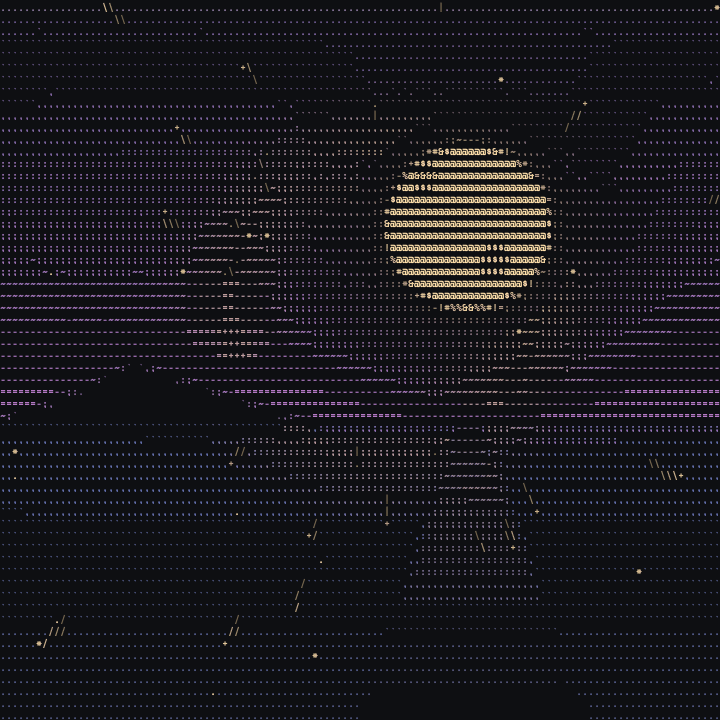
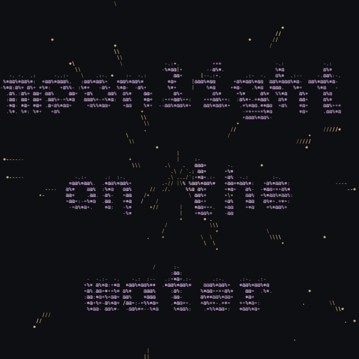

<h1 align="center">coverwave</h1>

<p align="center">
  A music player that draws the album cover in text and lets it move with the song.<br>
  In your terminal, and on your iPhone.
</p>

<p align="center">
  
</p>

<p align="center">
  <a href="https://github.com/Finn-Wyll/coverwave/releases/tag/latest-build"><b>Download</b></a>
  &nbsp;&nbsp;
  <a href="#build-from-source">Build from source</a>
  &nbsp;&nbsp;
  <a href="ios/README.md">iPhone app</a>
</p>

Each cover gets its own motion. coverwave reads the picture (rain, neon, night sky, ocean...) and the song's genre, then picks a few of 31 animation layers to run over the art, timed to the music. The same cover always moves the same way, on every machine.

## Install

**macOS, Linux and Windows.** Grab the file for your system from the [latest build](https://github.com/Finn-Wyll/coverwave/releases/tag/latest-build), unpack it and run it:

```sh
tar -xzf coverwave-macos-arm64.tar.gz
./coverwave ~/Music
```

On macOS, if the download is blocked, run `xattr -d com.apple.quarantine coverwave` once. The first run downloads the cover-analysis model (45 MB) from Hugging Face.

**With Rust installed,** build and install the `coverwave` command instead:

```sh
cargo install --git https://github.com/Finn-Wyll/coverwave cw-tui
```

## What it follows

| Source | How | Needs |
|---|---|---|
| Your music files | its own gapless player (FLAC, MP3, AAC, ALAC, Ogg, WAV) | a folder of music |
| Spotify | the Web API, with a one-time browser login | a Spotify app client ID; Premium to control playback |
| Apple Music | AppleScript on the Mac | macOS |
| Spotify downloads | the Spotify app itself, with saved covers and lyrics (no lookups) | Spotify on the same device; on iPhone, Spotify needs the internet to accept the connection |

On the Mac, coverwave listens to Spotify or Music directly (with the screen and audio recording permission), so their covers react to the real sound. Where it cannot listen, the motion follows the song's rhythm, measured from its 30-second preview.

## Lyrics

<table>
  <tr>
    <td width="50%"></td>
    <td>
      Press <code>l</code> and the lyrics take the cover's place, line by line in time with the song. The cover's motion keeps running over the letters.<br><br>
      Show the current line big or all lines as text, scroll up or down, and colour the letters with the accent or with the cover's own pixels.<br><br>
      Lyrics come from a <code>.lrc</code> file next to the song, its tags, or <a href="https://lrclib.net">LRCLIB</a>.
    </td>
  </tr>
</table>

## Keys

| Key | Does |
|---|---|
| `space` `n` `p` | play or pause, next, previous |
| `←` `→` | seek 5 s (with shift, 30 s) |
| `tab` `/` | library, search |
| `S` | choose a source |
| `l` | lyrics |
| `c` `m` | cover colours, motion on or off |
| `,` | settings |
| `?` | every key |

Settings save to `~/.config/coverwave/config.toml`, which is written with comments on first run. In Ghostty, coverwave shrinks its window's font while it runs for finer art, and puts it back on quit.

## iPhone

The iPhone app runs the same Rust core, wrapped in SwiftUI. It follows Spotify (on any device, with a device picker) or Apple Music, and you control playback with gestures on the cover. It has the same lyrics, a library and queue, and an Offline mode that follows the Spotify app directly while it plays your downloads, using only what coverwave saved ahead. It does not use the microphone. Setup is in [ios/README.md](ios/README.md).

## How it works

1. **Read the cover.** A small image model (MobileCLIP) scores the cover against scenes like rain, fire, space and city lights. Its palette gives one accent colour.
2. **Write a recipe.** The scenes, the genre and a seed from the cover's bytes choose the animation layers and their settings. The recipe is plain JSON, cached per cover.
3. **Draw each frame.** A pure renderer turns recipe, cover and the current audio levels into a grid of characters. It keeps the subject still, loops seamlessly, and limits how many characters change at once, so the motion supports the art rather than burying it.

Beats show as a ripple from the subject's edge, never as full-screen flashes. The full design is in [PLAN.md](PLAN.md).

## Build from source

```sh
git clone https://github.com/Finn-Wyll/coverwave && cd coverwave
cargo run -p cw-tui --release -- ~/Music
```

Linux also needs ALSA headers (`libasound2-dev pkg-config`). Before a pull request, run:

```sh
cargo fmt --all && cargo clippy --workspace --all-targets -- -D warnings && cargo test --workspace
```

| Folder | Holds |
|---|---|
| `crates/cw-core` | shared types, colour, the play queue, recipes, lyrics, rhythm maps |
| `crates/cw-analysis` | cover analysis, the image and beat models, recipe choice |
| `crates/cw-render` | the renderer: base art, motion layers, lyrics |
| `crates/cw-audio` | decoding, gapless playback, audio analysis |
| `crates/cw-library` | the music library, search, playlists |
| `crates/cw-capture` | listening to other apps (macOS process tap) |
| `crates/cw-sources` | Spotify, Apple Music, offline copies |
| `crates/cw-ffi` | the core for iOS (UniFFI) |
| `frontends/cw-tui` | the terminal app |
| `ios` | the iPhone app |

Every push to `main` builds the apps on GitHub and refreshes the [latest build](https://github.com/Finn-Wyll/coverwave/releases/tag/latest-build); version tags (`v0.2.0`) get a release of their own.

## Credits

- [MobileCLIP](https://github.com/apple/ml-mobileclip) by Apple reads the covers. Its weights are for research and personal use, so coverwave downloads them on first run and never ships them.
- [Beat This!](https://github.com/CPJKU/beat_this) (MIT) measures each song's rhythm on the iPhone.
- [Space Mono](https://github.com/googlefonts/spacemono) (SIL Open Font License) draws the big lyric letters.
- [LRCLIB](https://lrclib.net) provides lyrics, and [Deezer's API](https://developers.deezer.com) provides previews, tempos and genres. Neither needs a key.
- The cover in the animations above is an original image made for this page (`docs/media/demo-cover.jpg`), rendered by `cargo run -p cw-render --release --example readme_media`.

## License

[MIT](LICENSE), except the bundled font and the models, which keep their own licences.
